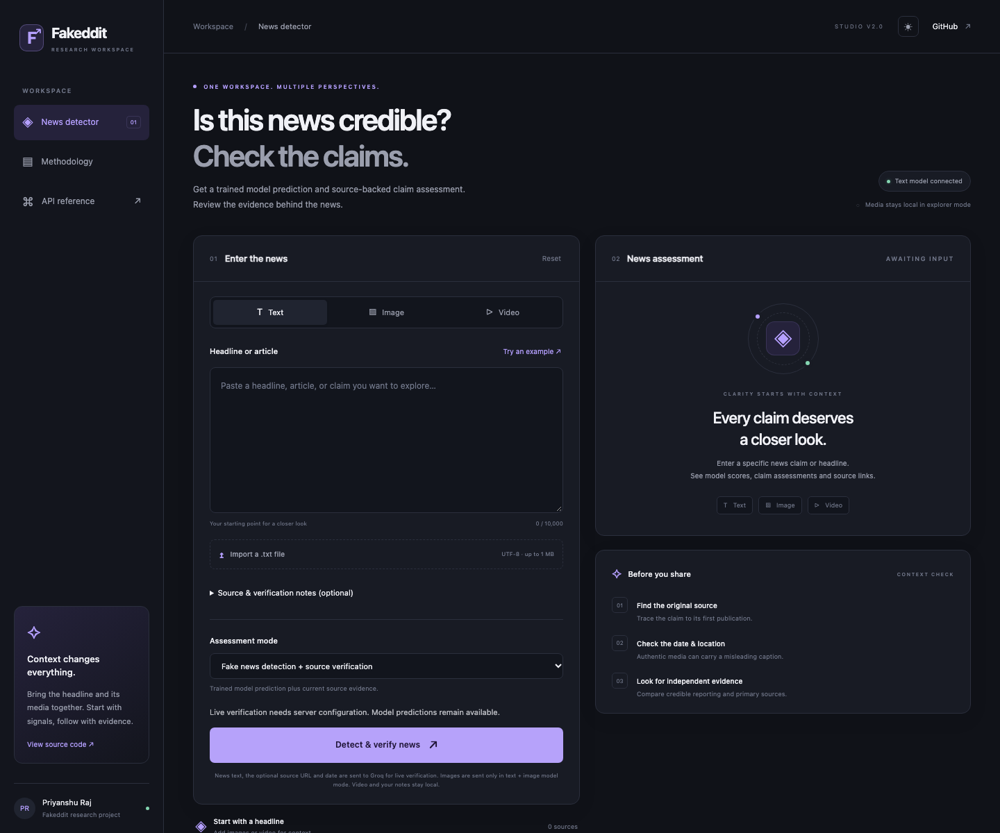
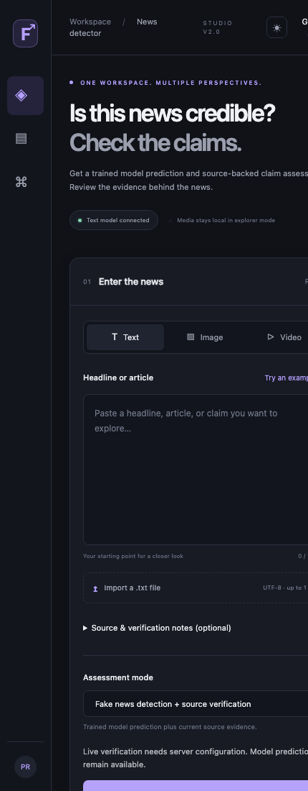
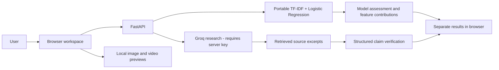
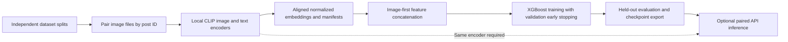

<div align="center">

# FAKEDDIT
### Multimodal Fake News Detection

**An evaluated headline classifier, independent source verification, and a reproducible text + image research pipeline.**

[](https://github.com/Priyanshuraj0909/Fakeddit-Multimodal-FakeNews/actions/workflows/tests.yml)


[**Live Demo ↗**](https://fakeddit-multimodal-fakenews.vercel.app) · [Documentation](#documentation) · [Quick Start](#quick-start) · [Evaluation](#model-performance) · [API](#api-reference)

| Test accuracy | Test macro F1 | Train / validation / test |
| :---: | :---: | :---: |
| **80.65%** | **0.8031** | **150,000 / 15,000 / 15,000** |

<sub>Recorded text-v1 results on independent Fakeddit subsets. Dataset classification performance is not real-world fact-checking accuracy.</sub>

</div>

---

## Overview

Misinformation can appear in a headline, an image, or the relationship between them. A text classifier can recognize patterns learned from a dataset, but language alone cannot establish whether an event actually happened. Multimodal learning adds visual context; evidence research asks a separate question about support for specific claims.

Fakeddit brings these approaches into a FastAPI application with a browser workspace and offline ML tools. The main detector produces two independent assessments:

1. **Model prediction:** a bundled TF-IDF + Logistic Regression model assesses English headline patterns, with uncertainty, abstention, and signed feature contributions.
2. **Claim verification:** when configured, Groq browser research retrieves sources and assesses up to five central claims, retaining citations and evidence limitations.

Model and evidence results can disagree. The application does not combine them into a truth probability. Original notebooks and historical results are preserved alongside the newer pipeline, release provenance, API contracts, and automated tests.

## Application preview

[Open the hosted workspace](https://fakeddit-multimodal-fakenews.vercel.app).



<details>
<summary>View the responsive layout</summary>



</details>

*Actual local application captures. Text, image, and video tabs are visible; their availability does not imply image or video classification. Live claim reports require server credentials. No simulated prediction or evidence report is shown.*

## Capabilities and readiness

| Capability | Status | What is available |
| --- | --- | --- |
| Text classification | Implemented; evaluated release bundled | TF-IDF + Logistic Regression; likely fake/misleading or likely real dataset classes |
| Uncertainty and abstention | Implemented | Scores below 0.65 are uncertain; unusable text receives no verdict |
| Text feature contributions | Implemented | Signed contributions to the linear model score, separate from factual evidence |
| Claim verification | Implemented; requires `GROQ_API_KEY` | Source research, per-claim verdicts, citations, and explicit provider failure status |
| Browser workspace | Implemented | Text import, assessment modes, source/date context, JSON export, theme switching, responsive layout |
| Image/video inspection | Implemented; browser local | Previews and metadata; authenticity is not assessed |
| CLIP + XGBoost pipeline | Experimental; requires artifacts | Local paired extraction, feature fusion, training, evaluation, and optional API inference |
| Standalone image benchmark | Pending | No independently evaluated image release bundled |
| Video inference / image attribution | Planned | No deployed classifier or image attribution path |

Missing paired checkpoints return **503 unavailable**, never replacement predictions. Groq being configured does not establish that a live verification request will succeed. Consult `/api/capabilities` for runtime readiness.

## Technology stack

| Area | Verified technologies |
| --- | --- |
| Languages | Python 3.12, JavaScript ES modules, HTML, CSS |
| Text ML / NLP | scikit-learn, TF-IDF, Logistic Regression; portable Python inference |
| Multimodal research | PyTorch, Transformers CLIP, NumPy, pandas, XGBoost |
| Historical notebooks | ResNet18, RoBERTa, CLIP, deep fusion and classifier comparisons |
| Backend | FastAPI, Uvicorn, Pydantic, HTTPX, Pillow, python-multipart |
| Frontend | Native browser modules; no bundler or frontend framework |
| External AI service | Groq API with browser search and structured claim assessments |
| Hosting / packaging | Vercel configuration, Dockerfile, Docker Compose |
| Verification / tools | pytest, Node test runner, browser smoke scripts, GitHub Actions, Git |

Heavy training and CLIP dependencies are optional. The bundled text release runs without scikit-learn, PyTorch, or joblib at inference time.

## System architecture



`/api/detect` assesses the first nonempty headline line, capped at 400 characters, with the classifier. Verification receives the submitted text and optional source URL/date, independently of the classifier score. The API accepts up to 10,000 text characters. Descriptive writing indicators are available as a separate mode.

The optional paired path has a separate artifact lifecycle:



No database, persistent upload history, OCR, or video classifier is implemented. See [architecture](docs/ARCHITECTURE.md) and [model contracts](docs/MODEL.md).

## Machine learning pipeline


The text-v1 release uses `clean_title`, unigram/bigram features, sublinear term frequency, L2 normalization, and a maximum of 40,000 vocabulary features. Candidates use `C ∈ {0.1, 1, 10}`; validation macro F1 selected **C = 1.0**, with seed **42**.

For a term occurring `tf` times, the vectorizer uses sublinear frequency `1 + log(tf)` and smoothed inverse document frequency `log((1 + N) / (1 + df)) + 1`, then normalizes the document vector. Logistic Regression computes `P(class 1 | x) = 1 / (1 + exp(-(w·x + b)))`. These scores have not been calibrated as probabilities of factual truth.

The 659,355-byte portable artifact stores vocabulary, IDF weights, coefficients, and provenance as gzip JSON. Its recorded export check compared 200 held-out headlines with scikit-learn, with maximum absolute probability error below `1e-10`. Full joblib checkpoints and research weights remain ignored. See [release manifest](docs/TEXT_MODEL_RELEASE.json).

For portable inference, fewer than three tokens, zero usable features, or vocabulary coverage below 20% causes abstention. A maximum class score below 0.65 is marked uncertain. These thresholds are product heuristics, not a measured calibration guarantee.

## Dataset and evaluation protocol

[Fakeddit's publisher repository](https://github.com/entitize/Fakeddit) provides access instructions. The [LREC 2020 paper](https://aclanthology.org/2020.lrec-1.755/) describes Reddit-derived text, images, metadata, and distantly supervised 2-way, 3-way, and 6-way labels. This application's release uses only the **text branch of the official v2 multimodal-only splits**.

| Binary label | Release display name | Mapping |
| --- | --- | --- |
| `0` | Likely fake / misleading | Other six-way categories |
| `1` | Likely real | Six-way class `0` (true) |

Preparation checks the mapping against every supplied row, preserves post IDs, excludes ID and normalized exact-text overlap, and takes fixed-seed subsets within official splits. TF-IDF is fitted on training only; validation selects the model; test is reserved for final evaluation. Paired training additionally checks image hashes, feature IDs/order, encoder fingerprints, and modality dimensions.

Raw datasets and downloaded images are **not committed**. Distant labels, Reddit/source bias, and incomplete semantic deduplication limit generalization. Near-duplicate and author-disjoint audits remain future work. See [dataset contracts](docs/DATASET.md).

## Model performance

All values below come from [the recorded text-v1 release](docs/TEXT_MODEL_RELEASE.json); this documentation update does not rerun benchmark training.

| Split | Samples | Accuracy | Macro F1 |
| --- | ---: | ---: | ---: |
| Training | 150,000 | Not recorded | Not recorded |
| Validation | 15,000 | 80.84% | 0.8054 |
| Test | 15,000 | **80.65%** | **0.8031** |

| Test class | Precision | Recall | F1 | Support |
| --- | ---: | ---: | ---: | ---: |
| Fake / misleading (`0`) | 0.8115 | 0.8468 | 0.8288 | 8,297 |
| Real (`1`) | 0.7996 | 0.7565 | 0.7775 | 6,703 |
| Macro average | 0.8055 | 0.8017 | 0.8031 | 15,000 |
| Weighted average | 0.8062 | 0.8065 | 0.8058 | 15,000 |

**Confusion matrix** — rows are actual labels; columns are predicted labels:

| Actual ↓ / Predicted → | Fake / misleading | Real |
| --- | ---: | ---: |
| Fake / misleading | 7,026 | 1,271 |
| Real | 1,632 | 5,071 |

These are conventional held-out classification metrics, not a separate evaluation of the UI's abstention policy or Groq verification. No verified multimodal benchmark is published for the new pipeline. Historical notebook results, including the previously reported 93.9%, are not comparable release metrics; [the historical review](PROJECT_REVIEW.md) documents evaluation and leakage concerns.

## Quick start

Use **Python 3.12** and **Node.js 20+**; Node is needed for frontend checks, not for serving the application. Run commands from the repository root.

```bash
git clone https://github.com/Priyanshuraj0909/Fakeddit-Multimodal-FakeNews.git
cd Fakeddit-Multimodal-FakeNews
bash scripts/setup.sh
.venv/bin/python -m uvicorn backend.app.main:app --reload
```

`setup.sh` creates `.venv` with `python3.12` and installs `requirements-test.txt`, including application and training/test dependencies. For a lighter serving-only environment:

```bash
python3.12 -m venv .venv
.venv/bin/python -m pip install -r requirements-app.txt
.venv/bin/python -m uvicorn backend.app.main:app --reload
```

Open **http://127.0.0.1:8000** for the frontend or **http://127.0.0.1:8000/docs** for interactive OpenAPI documentation. FastAPI serves the HTML and browser modules directly; no `npm install` or frontend build is required.

On macOS, including Apple Silicon, XGBoost may require OpenMP (`brew install libomp`). CLIP execution is optional; the documented extraction path runs on CPU, with no claim of GPU/MPS validation.

### Environment configuration

| Variable | Required? | Purpose |
| --- | --- | --- |
| `GROQ_API_KEY` | Only for evidence verification | Server-side Groq credential; never expose in frontend code |
| `GROQ_VERIFICATION_MODEL` | Optional | Defaults to `openai/gpt-oss-20b`; provider must support the required search/structured-output path |
| `FAKEDDIT_MODEL_DIR` | Optional override | Trusted local text checkpoint directory; omit for bundled text-v1 |
| `FAKEDDIT_MULTIMODAL_DIR` | Only for paired inference | Exported compatible multimodal classifier directory |
| `FAKEDDIT_ENCODER_DIR` | Only for paired inference | Complete local CLIP snapshot matching the classifier manifest |

See [.env.example](.env.example). Local Uvicorn does **not** load it automatically. One option is to export the variables in your shell before starting; another is:

```bash
cp .env.example .env
# Edit .env locally; keep credentials out of Git.
.venv/bin/python -m pip install python-dotenv
.venv/bin/python -m uvicorn backend.app.main:app --reload --env-file .env
```

Without Groq credentials, text predictions, descriptive analysis, previews, and exports work; verification reports unavailable/not checked. Missing or incompatible explicit model overrides remain unavailable. See [verification setup](docs/VERIFICATION_SETUP.md).

### Run checks

After the full setup:

```bash
bash scripts/verify.sh
```

This runs pytest, JavaScript syntax checks, Node tests, and `git diff --check`. [Browser smoke scripts](tests/browser/) cover interactive workflows; some evidence-rendering checks explicitly use mocks. Synthetic contract tests do not reproduce real-data benchmark accuracy. See [verification record](docs/VERIFICATION.md).

## API reference

No API authentication or persistence is implemented. Interactive `/docs` and the running `/openapi.json` describe request schemas; response contracts are also documented in [docs/API.md](docs/API.md).

| Method | Endpoint | Request | Response purpose |
| --- | --- | --- | --- |
| GET / HEAD | `/api/health` | None | Service status, model availability and readiness |
| GET | `/api/capabilities` | None | Enabled modes, verification configuration, upload limits |
| POST | `/api/detect` | JSON `text`; optional `source_url`, `publication_date` | `mode`, `model_assessment`, `verification`, `note` |
| POST | `/api/analyze` | JSON `text` | Descriptive counts/indicators; no truth judgment |
| POST | `/api/predict` | JSON `text` | Dataset label, model scores/status, release metadata where available |
| POST | `/api/predict/multimodal` | Multipart `text` + `image` | Paired label/scores and artifact provenance; requires separate assets |

```bash
curl http://127.0.0.1:8000/api/health

curl -X POST http://127.0.0.1:8000/api/detect \
  -H 'Content-Type: application/json' \
  -d '{"text":"Scientists discover a new species in the rainforest"}'

curl -X POST http://127.0.0.1:8000/api/predict \
  -H 'Content-Type: application/json' \
  -d '{"text":"Scientists discover a new species in the rainforest"}'

# Requires your compatible encoder, paired checkpoint, and local image:
curl -X POST http://127.0.0.1:8000/api/predict/multimodal \
  -F 'text=A headline to assess' -F 'image=@data/images/001.jpg'
```

Model assessment statuses include `ready`, `uncertain`, `abstained`, and `unavailable`. Completed verification includes a summary, claims with `evidence_ids`, and sources with titles/URLs/publishers; claim verdicts are `supported`, `contradicted`, `mixed`, or `insufficient_evidence`. Provider failure produces unavailable verification and `not_checked`, preserving the model result.

Text must be nonempty and at most 10,000 characters. Schema errors return **422**, unsupported image formats **415**, oversized uploads **413**, and missing/incompatible classifier assets **503**. Paired image limits are 10 MiB locally and 4 MiB on Vercel. Research calls have process-local rate limiting; see [the backend implementation](backend/app/core/rate_limit.py).

## Training and reproducibility

### Reproduce text-v1

Obtain the official files through the publisher and place `multimodal_train.tsv`, `multimodal_validate.tsv`, and `multimodal_test_public.tsv` in `data/raw/`. Install optional training dependencies, then run:

```bash
.venv/bin/python -m pip install -r requirements-training.txt
.venv/bin/python scripts/prepare_text_release.py
.venv/bin/python scripts/train.py text \
  --train data/processed/text-release-v1/train.csv \
  --validation data/processed/text-release-v1/validation.csv \
  --test data/processed/text-release-v1/test.csv \
  --labels data/processed/text-release-v1/labels.json \
  --label-source https://github.com/entitize/Fakeddit/issues/14 \
  --max-features 40000 --output models/exported/text-release-v1
.venv/bin/python scripts/export_text_release.py \
  --directory models/exported/text-release-v1 \
  --provenance data/processed/text-release-v1/provenance.json \
  --parity-dataset data/processed/text-release-v1/test.csv
```

Use fresh output directories for repeat experiments. Export writes the portable release; review changes deliberately before replacing versioned inference artifacts. The [release manifest](docs/TEXT_MODEL_RELEASE.json) records source hashes, exclusions, sampling, metrics, and artifact checksum. Load joblib files only from trusted training runs.

### Multimodal research

Supply paired images, independent splits, verified label metadata, and a complete local Hugging Face CLIP snapshot. Install `requirements-multimodal.txt`, then follow the [complete training guide](docs/TRAINING.md) for pairing, embedding extraction, evaluation, and checkpoint activation. Entry points expose their required inputs:

```bash
.venv/bin/python -m pip install -r requirements-multimodal.txt
.venv/bin/python scripts/preprocess.py pairs --help
.venv/bin/python scripts/preprocess.py embeddings --help
.venv/bin/python scripts/train.py multimodal --help
```

The pipeline performs image-first feature concatenation and CPU XGBoost classification, with optional modality ablations. It does not automatically download an encoder. Original [notebooks](notebooks/) and the [historical workbook](results/multimodal_results-5.xlsx) retain research provenance; they are not proof of reproducible deployed multimodal accuracy.

## Deployment

The repository contains a Vercel FastAPI entrypoint and serves frontend assets through the API. The configured [public demo](https://fakeddit-multimodal-fakenews.vercel.app) bundles portable text-v1. Set `GROQ_API_KEY` in the server's Vercel Production environment and redeploy to enable evidence research. A Git push alone does not prove successful deployment; verify public behavior with:

```bash
.venv/bin/python scripts/check_deployment.py
```

On 2026-10-21, the public deployment check passed for the homepage, GET/HEAD availability, frontend assets, API health, capabilities, descriptive analysis, and trained detection. Live Groq verification was not established by that check.

Vercel configuration caps runtime at 60 seconds; verification has a 50-second deadline. Large CLIP workloads require separate resource planning and artifacts. Read [deployment details](docs/DEPLOYMENT.md) and [verification setup](docs/VERIFICATION_SETUP.md).

Docker configuration is also provided:

```bash
docker compose up --build
```

The image installs lightweight application requirements and copies the bundled text release. Compose reads `.env.example`; configure real server credentials through your local deployment environment/Compose configuration. Paired inference additionally needs matching optional dependencies and mounted artifacts. **Docker execution has not been verified in this update.**

## Project structure

```text
backend/app/          FastAPI routes, schemas, upload handling, verification
  models/releases/    Versioned compact evaluated text inference release
backend/tests/        API and detector regression tests
frontend/index.html   Browser entrypoint served by FastAPI
frontend/src/         Pages, services, state, reports, media utilities, CSS
ml/                   Dataset pairing, preprocessing, models, training, evaluation
scripts/              Setup, preparation, training, export, deployment checks
notebooks/            Seven original Colab research notebooks
results/              Preserved historical experiment workbook
tests/                ML contracts, frontend unit tests, browser smoke scripts
docs/                 Architecture, API, dataset/model guides, phase records
  assets/             Actual application screenshots
data/                 Ignored local datasets and generated features
models/               Ignored local encoder snapshots and full checkpoints
.github/workflows/    Project CI and public deployment checks
```

## Limitations and responsible use

- **Dataset bias and domain shift:** Reddit-derived headline patterns and distant labels do not establish generalization to modern reporting, long articles, or other languages.
- **Model errors and score interpretation:** false positives and false negatives occur. Scores are uncalibrated; uncertainty thresholds are heuristics. Text contributions explain model patterns, not factual causation.
- **Evidence quality:** retrieved excerpts can be incomplete, outdated, or unreliable. LLM claim assessments can hallucinate or misinterpret sources. Read cited primary material and check dates/context.
- **Leakage coverage:** exact content and ID checks do not replace near-duplicate, semantic overlap, or author/source-disjoint evaluation.
- **Incomplete modalities:** no bundled evaluated CLIP fusion model, image manipulation detector, OCR, or video inference. Local media previews do not verify authenticity.

Use reports to guide review. Do not treat them as definitive truth judgments or as the sole basis for consequential decisions.

## Roadmap

- [x] Evaluate and bundle a lightweight text baseline with recorded provenance.
- [x] Implement separate claim research, citations, and explicit failure states.
- [x] Add API/frontend contracts and offline paired training tools.
- [ ] Train and independently evaluate real CLIP fusion checkpoints and modality ablations.
- [ ] Evaluate calibration, domain shift, near duplicates, and author/source shortcuts.
- [ ] Evaluate standalone image models and add validated image explanations.
- [ ] Expand robustness datasets and deployment monitoring.
- [ ] Validate Docker execution and document multimodal resource requirements.

Engineering implementation and real-model readiness are tracked separately in [PLAN.md](PLAN.md) and [phase guides](docs/phases/).

## Documentation

| Topic | Guides |
| --- | --- |
| Project workflow | [Master workflow](MASTER_ORCHESTRATOR.md), [implementation plan](PLAN.md), [change log](CHANGELOG.md) |
| Application | [Architecture](docs/ARCHITECTURE.md), [API](docs/API.md), [backend](backend/README.md) |
| Data and models | [Dataset](docs/DATASET.md), [models](docs/MODEL.md), [release provenance](docs/TEXT_MODEL_RELEASE.json), [training](docs/TRAINING.md) |
| Operations | [Deployment](docs/DEPLOYMENT.md), [verification](docs/VERIFICATION.md), [Groq setup](docs/VERIFICATION_SETUP.md) |
| Research and audit | [Historical review](PROJECT_REVIEW.md), [project audit](docs/PROJECT_AUDIT.md), [repair report](docs/REPAIR_REPORT.md) |

Some historical guides describe earlier artifact availability or paths. For the current bundled text release, use this README, `docs/MODEL.md`, and `docs/TEXT_MODEL_RELEASE.json`; dated reviews remain provenance.

## Research credits

Dataset credit: **Kai Nakamura, Sharon Levy, and William Yang Wang (2020)**, [*Fakeddit: A New Multimodal Benchmark Dataset for Fine-grained Fake News Detection*](https://aclanthology.org/2020.lrec-1.755/), LREC, pp. 6149–6157. See the [official dataset repository](https://github.com/entitize/Fakeddit) for access and usage terms.

The optional encoder path uses [Hugging Face CLIP](https://huggingface.co/docs/transformers/model_doc/clip); historical experiments and the paired pipeline are separate from the bundled text model.

## Contributing, license, and author

Follow [AGENTS.md](AGENTS.md), read the plan and affected phase guide, and preserve research notebooks/results. Keep API code in `backend/app`, browser code in `frontend/src`, and offline ML in `ml`. Include appropriate checks with changes, retain independent data splits, and never commit datasets, secrets, environments, or full research checkpoints.

**License:** no project license file is present. No open-source license grant is asserted here; dataset and dependency terms are separate.

**Developed by [Priyanshu Raj](https://github.com/Priyanshuraj0909).**
